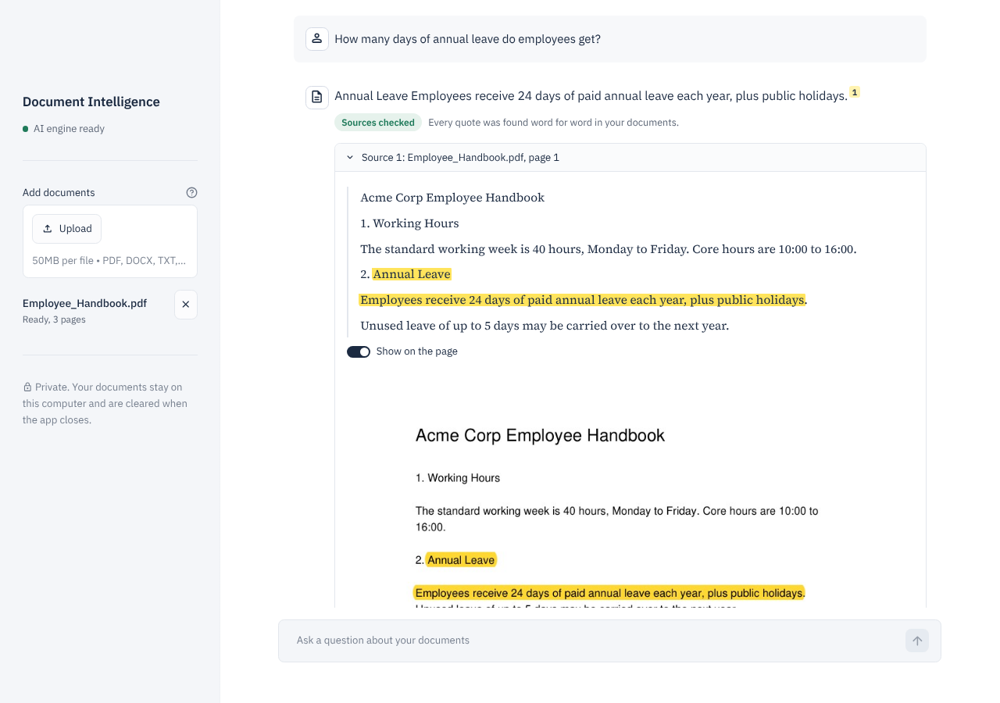
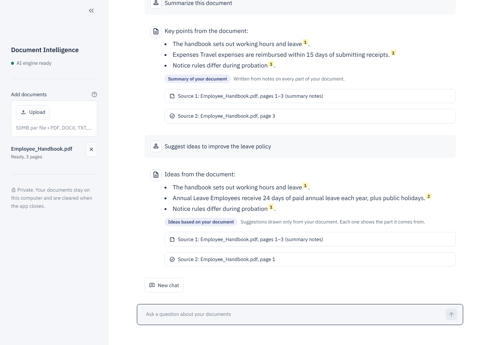
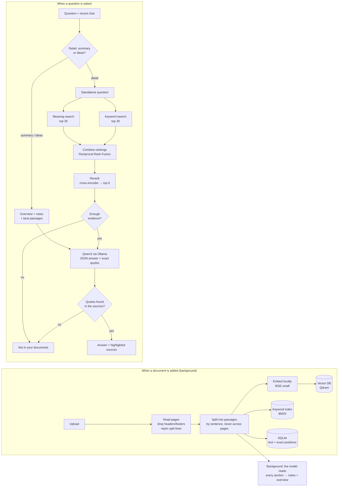

# Document Intelligence

[](https://github.com/YOUR-GITHUB-USERNAME/offline-document-intelligence/actions/workflows/ci.yml)


**Private, offline question answering over your own documents.** Upload PDFs, Word files or text, then look up details, ask for summaries and key points, or brainstorm ideas, all strictly from your documents, with the exact source lines highlighted on the page. If the answer isn't in your documents, the app says so instead of guessing.

Everything runs on your computer: the language model (Qwen3 via Ollama), the search models, the database and the interface. No document, question or answer is sent anywhere, and documents are wiped when the app closes.

**Stack:** Python · FastAPI · Qdrant · BM25 · sentence-transformers (BGE embeddings + cross-encoder reranker) · Ollama (Qwen3 14B) · Streamlit · Docker · pytest



---

## What the user sees

1. **Add documents.** Each file shows *Reading…* and then *Ready* (or a plain-language reason if it can't be read). Processing happens in the background. While the AI then reads the document in full, the sidebar shows *Reading it in full for summaries*; questions can be asked straight away.
2. **Ask anything** about all documents or one of them, as a conversation. Follow-ups such as *"and the second one?"* are understood from the earlier questions.
3. **The answer is written as you watch**, then shown with its sources. Each source shows the passage with the quoted words highlighted, and can show the original PDF page with the same highlight.
4. **Three kinds of answer**, chosen automatically:

   | You ask | You get | Label |
   |---|---|---|
   | A detail: *"What is the notice period?"* | A precise answer with verbatim quotes | *Sources checked* |
   | The big picture: *"Summarize this"*, *"Key risks?"* | A summary of the whole document | *Summary of your document* |
   | Ideas: *"How could we improve onboarding?"* | Suggestions that each point to the part of the document they come from | *Ideas based on your document* |

5. **"Not in your documents"** when the documents don't cover the question. Brainstorming never uses outside knowledge: ideas without a source in the document are not shown.



There are no settings, scores or technical terms in the interface. Those live in this README and in the benchmark.

## How it works



**Whole-document questions.** Search finds passages whose *words* match the question, which works for details but not for *"summarize this"* or *"what are the risks?"*: no single passage contains the answer. So after a document is ready, a second background worker has the local model read it in full, about 9,000 characters at a time, writing short page-referenced notes for each section and then an overview from those notes. Summary and brainstorming questions are answered from the overview, the notes (the most relevant ones if there are many) and the best matching passages. The answer cites notes as *"pages 4–7 (summary notes)"* and passages with verbatim quotes, and an answer that cites nothing from the documents is withheld. The worker pauses whenever a question is being answered, and catches up automatically if the AI engine was off when the document was added.

**Understanding the question.** Before searching, the model classifies each question as a detail, a summary or a brainstorm, and rewrites follow-ups to stand alone using the last three turns (*"can that be carried over?"* → *"Can unused annual leave be carried over?"*), so the search looks for the right thing. Without the model, simple keyword rules do the routing.

**Streaming.** The API's `/query/stream` sends the answer as it is generated (newline-delimited JSON), and the interface writes it word by word. Each update redraws only the answer, and the interface's fade-on-update is switched off, so the page stays steady.

**Why two kinds of search?** Meaning search finds paraphrases ("kept" ≈ "retained") but blurs exact codes; keyword search finds exact terms (error code `E04`, clause `9.2`) but misses synonyms. Reciprocal Rank Fusion combines both rankings without having to compare their incompatible scores, and a cross-encoder then re-reads the best 30 candidates with the question to pick the 6 most relevant.

**Why answers can be trusted.** The model must return a short *verbatim quote* for every source it cites, as structured JSON. Each quote is searched for in the original passage (exactly, then fuzzily), and its position is recorded so the UI can highlight it. There are three independent ways an answer gets refused:

| Check | What it catches |
|---|---|
| Evidence gate | The best passage is only weakly related, so the model is never asked (saves time, prevents guessing) |
| Model refusal | The model is instructed to say when the passages don't contain the answer |
| Quote verification | The model answered, but none of its quotes exist in the documents |

## Privacy by design

| Guarantee | How |
|---|---|
| The language model is local | Ollama on `localhost`. There is no cloud AI code in the project at all |
| Search models are local | Downloaded once into `models/`, then loaded with the model libraries forced into offline mode |
| The interface is local | Fonts are bundled (`ui/static/fonts`); no CDN or Google Fonts; Streamlit usage statistics off |
| Nothing is left behind | Uploaded files, text and vectors are wiped when the app starts and when it closes (`KEEP_DOCUMENTS=false`) |
| It's tested | `tests/test_offline.py` blocks every non-local network connection and runs the full flow: upload, read, ask, answer, page preview. Any attempt to reach the internet fails the test |
| Docker stays local | Ports bound to `127.0.0.1`; Qdrant telemetry disabled |

The only steps that need internet are the one-time setup: installing packages, `ollama pull`, and `python scripts/download_models.py`.

---

## Setup (Windows, VS Code)

**Tested with:** Windows 11, Python 3.13, Ollama with `qwen3:14b` on an RTX 5080 (16 GB), 32 GB RAM. Answers take a few seconds on a GPU like this. Without a GPU it still works, more slowly; consider `qwen3:8b`.

### 1. Ollama and the model
Install Ollama from [ollama.com](https://ollama.com), then in PowerShell:
```powershell
ollama pull qwen3:14b
```
The app requests an 8192-token context on every call, so no Ollama settings are required.

### 2. Get the code
```powershell
git clone https://github.com/YOUR-GITHUB-USERNAME/offline-document-intelligence.git
cd offline-document-intelligence
code .
```
Install the recommended extensions when VS Code asks.

### 3. Virtual environment
In the VS Code terminal (`` Ctrl+` ``):
```powershell
py -3.13 -m venv .venv          # or: python -m venv .venv
.\.venv\Scripts\Activate.ps1    # if blocked: Set-ExecutionPolicy -Scope CurrentUser RemoteSigned
```
Then `Ctrl+Shift+P` → **Python: Select Interpreter** → the one in `.venv`.

### 4. Install packages
```powershell
python -m pip install --upgrade pip
pip install -r requirements.txt
```

### 5. Download the search models (one time, about 250 MB)
```powershell
python scripts/download_models.py
```
It saves two models into `models/` and confirms that Ollama has `qwen3:14b`. **After this, the internet can be switched off.**

### 6. Run the tests
```powershell
python -m pytest -q
```

### 7. Start the app
**Run and Debug** (`Ctrl+Shift+D`) → **API + UI** → **F5**. Open **http://localhost:8501**.

Without the debugger, use two terminals (activate `.venv` in each):
```powershell
uvicorn app.api.main:app --port 8000
streamlit run ui/streamlit_app.py
```

Settings are optional: copy `.env.example` to `.env` to change them.

---

## Benchmark (for developers)

The benchmark measures retrieval and answers on **your own documents** with a small file of labelled questions. It works in a temporary folder of its own, so it never touches the app's documents and can run while the app is open.

```powershell
python -m evaluation.run_eval --docs path\to\documents --dataset path\to\questions.jsonl
python -m evaluation.run_eval --docs ... --dataset ... --generate vector hybrid_rerank --judge
```

**Question file** (`.jsonl`, one question per line):
```json
{"id": "q1", "question": "What notice period applies during probation?", "answerable": true, "doc": "handbook.pdf", "pages": [2], "evidence": "notice period is 7 days", "reference": "7 days", "key_facts": ["7 days"]}
{"id": "u1", "question": "What is the parental leave policy in Germany?", "answerable": false}
```
`evidence` is a short phrase copied exactly from the right page. Include some unanswerable questions that sound plausible, since they test the refusals. About 30 answerable and 8 unanswerable questions give meaningful numbers.

| Metric | Meaning |
|---|---|
| Recall@k, MRR, nDCG@5 | Did each search method put a passage containing the evidence in the top k, and how high? |
| answer_correctness | Share of required facts present in the answer (refusing an answerable question scores 0) |
| llm_judge (`--judge`) | The local model grades each answer 0 / 0.5 / 1 against the reference |
| citation_precision | Share of citations that are verified **and** point at the right page |
| quote_verified_rate | Share of the model's quotes found in the source text |
| abstain precision / recall | Refusals that were right / unanswerable questions that were refused |
| false_refusal_rate | Answerable questions wrongly refused |
| latency p50 / p95 | Typical and slowest response times |

It compares four search methods: **vector** (meaning only), **bm25** (keywords only), **hybrid** (both, fused), and **hybrid_rerank** (hybrid + cross-encoder, used by the app). During answer generation the evidence gate is switched off and applied afterwards, so the report includes a **threshold sweep** showing refusal quality at every threshold; set `ABSTAIN_THRESHOLD` from it. Reports are saved in `reports/` as JSON, Markdown and CSV.

Question files and reports are ignored by Git (`evaluation/datasets/`, `reports/`), because they quote your documents.

---

## Configuration (`.env`, all optional)

| Setting | Default | Purpose |
|---|---|---|
| `OLLAMA_MODEL` | `qwen3:14b` | Any model pulled into Ollama |
| `OLLAMA_CONTEXT` | `8192` | Tokens the model reads at once; sent with every request |
| `LLM_PROVIDER` | `ollama` | `extractive` answers by quoting sentences, with no model |
| `KEEP_DOCUMENTS` | `false` | `true` keeps documents between restarts |
| `PREPARE_OVERVIEWS` | `true` | Read each document in full in the background, for summaries and ideas |
| `ABSTAIN_THRESHOLD` | `0.30` | Minimum evidence relevance before the model is asked |
| `CHUNK_SIZE` / `CHUNK_OVERLAP` | `600` / `100` | Passage size and overlap, in characters |
| `TOP_K` | `6` | Passages given to the model |

If Ollama isn't running, the app keeps working: answers quote the most relevant sentences directly, and the interface says so.

## Project structure

```
doc-intel-ai/
├── app/
│   ├── config.py              settings (.env)
│   ├── local_models.py        loads search models from ./models, offline only
│   ├── pipeline.py            background processing, start-fresh storage, use-cases
│   ├── ingestion/             parser.py (PDF/DOCX/TXT), chunker.py
│   ├── store/                 metadata.py (SQLite + status), vector_store.py (Qdrant), bm25_index.py
│   ├── retrieval/             embeddings.py, fusion.py (RRF), reranker.py, retriever.py
│   ├── generation/            llm.py (Ollama), prompts.py, citations.py, answerer.py, digest.py (background notes)
│   └── api/main.py            FastAPI
├── ui/streamlit_app.py        the client interface (+ static/fonts)
├── evaluation/                benchmark: metrics.py, runner.py, run_eval.py
├── scripts/download_models.py one-time model download
├── tests/                     unit, pipeline, API, Ollama client, grounding, understanding/streaming, no-internet tests
└── Dockerfile, docker-compose.yml, .vscode/, .github/workflows/ci.yml
```

## API

| Method | Path | Purpose |
|---|---|---|
| GET | `/health` | AI-engine status (`ready`, `offline`, `missing_model`) and document counts |
| POST | `/documents` | Upload files; returns at once with status `processing` |
| GET | `/documents` | Documents with status `processing` / `ready` / `failed` (+ reason) |
| DELETE | `/documents/{id}` | Remove a document everywhere |
| GET | `/documents/{id}/pages/{n}/render?highlight=…` | Page image with the quote highlighted (PDF) |
| POST | `/query` | `{question, doc_ids?, history?}` → answer, verified citations, passages |
| POST | `/query/stream` | Same, streamed as NDJSON events: `status`, `delta` (answer text), `final` (the full answer) |

Interactive docs: http://localhost:8000/docs

## Design decisions

- **Passages never cross a page boundary**, so every citation is exactly one page, and each passage stores its character offsets for precise highlighting.
- **SQLite is the source of truth**; Qdrant and BM25 are derived from it and can be rebuilt.
- **One background worker** reads documents in order, so uploads return instantly and the GPU isn't contested by parallel embedding jobs.
- **Ollama's native API**, not its OpenAI-compatible one, so each request can carry a JSON schema (`format`), switch off Qwen3's thinking step (`think: false`) and set the context window (`num_ctx`).
- **The reranker doubles as the evidence gate**: its 0–1 relevance decides whether the model is asked at all.
- **Summaries come from notes written in advance**, not from stuffing the whole document into the prompt: a long document doesn't fit the model's context, and pre-written notes make summary answers as fast as detail answers.
- **Questions take priority**: the background reader waits while a question is being answered, so it never slows the chat down by more than one in-progress note.
- **Start fresh by default**: wiping on start and on shutdown means a crash can't leave documents behind.

## Troubleshooting

| Problem | Fix |
|---|---|
| "The model … isn't on this computer yet" | Run `python scripts/download_models.py` once, with internet |
| Sidebar says "AI engine is off" | Start Ollama from the Start menu |
| "AI model not installed" | `ollama pull qwen3:14b` |
| "The app's engine isn't running yet" | Start the API (`uvicorn app.api.main:app --port 8000`) or wait for it to load |
| A file shows "No readable text was found" | It's a scanned image with no text layer. Scanned pages need Tesseract OCR set up for PyMuPDF (see PyMuPDF's OCR documentation); otherwise use a text-based PDF |
| Answers are slow | Check `ollama ps` shows `100% GPU`; a smaller model (`qwen3:8b`) is faster |
| Summaries say the document is still being read | Wait for *Reading it in full for summaries* to disappear from the sidebar (roughly 15–20 seconds per 10 pages on an RTX 5080) |
| Too many or too few refusals | Run the benchmark and set `ABSTAIN_THRESHOLD` from the threshold sweep |

## Docker

```powershell
docker compose up --build      # then open http://localhost:8501
```
Ollama keeps running on your computer (so it can use the GPU); the containers reach it at `host.docker.internal`. Building needs internet once; running doesn't.

## Limitations

- **Scanned PDFs** have no text layer; they need Tesseract OCR installed for PyMuPDF, otherwise they are reported as unreadable.
- **English-first**: the default search models are trained on English. Other languages work less well; a multilingual embedding model can be set in `.env`.
- **Single user, single computer**: there are no accounts or access control; it is designed to run on the machine that holds the documents.
- **Long documents** take a while to be read in full for summaries (roughly 15–20 seconds per 10 pages on an RTX 5080). Detail questions work as soon as a document is *Ready*.

